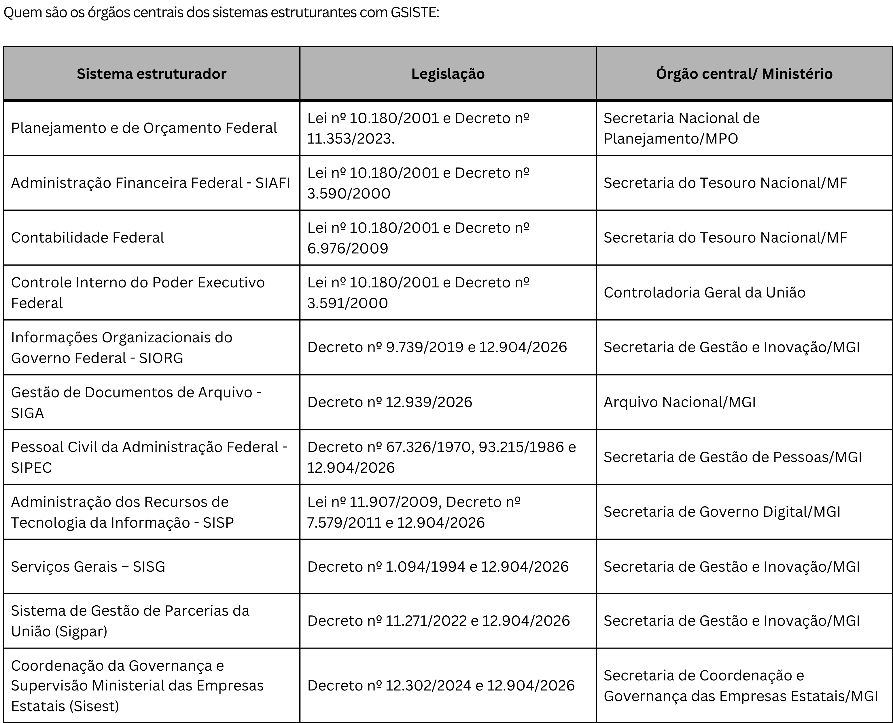

.. _gratif:

Gratificações temporárias no Poder Executivo federal
===========================================================

Aqui, estão reunidas informações sobre gratificações temporárias usadas para atrair e reter pessoal com vínculo efetivo no serviço público para determinadas unidades e/ou atividades específicas. O objetivo é compilar informações que sirvam como subsídio para a melhoria da gestão pública.
      
As gratificações temporárias se aproximam do conceito de funções de confiança para assessoramento técnico, com a diferença de que são instrumentos articulados com a política de gestão de pessoas e a arquitetura das carreiras. Tais gratificações atuam como um equalizador das diferenças remuneratórias entre cargos e carreiras heterogêneas, permitindo que parte dos servidores de carreiras transversais  sejam alocados para setores considerados críticos da gestão federal.

**São, assim, instrumento eficaz para atrair e reter servidores, pois viabilizam a cessão sem perda da gratificação de desempenho e sem a ocupação de cargo ou função comissionada**.
      
A análise das estruturas organizacionais deve considerar, de forma integrada, os cargos e funções comissionadas e as gratificações temporárias disponíveis nos órgãos e entidades, já que ambos os mecanismos apoiam a atração e retenção de talentos. Algumas gratificações temporárias são, inclusive, distribuídas por meio dos mesmos decretos que aprovam as estruturas dos órgãos da administração direta e indireta do Poder Executivo federal. Essa prática possibilita o seu cadastramento no sistema informatizado do SIORG, o que resulta em mais transparência, controle e facilidade de acesso a informações.
      
Além disso, com base no `art. 6º da Lei nº 14.204/2021 <lei-14204-art6_>`_, é possível transformar, sem aumento de despesa, eventuais gratificações temporárias subutilizadas em Funções Comissionadas Executivas (FCE), otimizando a gestão dos recursos disponíveis sem recorrer à criação de novas funções por via de lei.
      
Contudo,  por serem diferentes das funções de confiança, as gratificações temporárias que se articulam com a política de gestão de pessoas e a arquitetura das carreiras requerem uma análise mais profunda ao se cogitar a sua transformação. Além de serem peças na estratégia de gestão dos cargos e carreiras, as gratificações temporárias exclusivas para determinadas unidades ou atividades asseguram o seu fortalecimento direto e impedem a sua dispersão para outras áreas.
      
Por fim, o fato de uma gratificação temporária constar deste Anexo não significa que ela seja um instrumento eficiente ou sem necessidade de melhorias. O fato de constarem aqui visa unicamente compilar as informações disponíveis sobre a matéria e servir de insumo para o aprimoramento da gestão.

.. admonition:: O que **está** incluído
 
   Para fazer parte deste documento, a gratificação precisa atender a dois critérios obrigatórios:
      I -   concessão, designação, nomeação, retirada, dispensa ou exoneração mediante ato discricionário da autoridade competente; e 
      
      II -  não compor a remuneração do cargo efetivo, do emprego, do posto ou graduação, para qualquer efeito. 
   
   Existem também algumas características observadas na maioria das gratificações que estão incluídas neste Anexo, que são:
      a) quantitativo limitado, independentemente do número de servidores em exercício;
      b) elegibilidade vinculada ao órgão ou unidade de efetivo exercício e/ou à atividade realizada;
      c) possuem hierarquia interna, com níveis distintos de remuneração; e
      d) presença ou não nos decretos das estruturas organizacionais dos órgãos e entidades.

.. admonition:: O que **não está** incluído

   Ficam de fora deste documento as seguintes gratificações:
      * Gratificações de desempenho ou de qualificação que fazem parte da remuneração do cargo efetivo, emprego público, posto ou graduação, e não exigem ato formal de nomeação ou designação.
      * Gratificação de representação da carreira militar para os oficiais-generais e militares (`art. 10 da Lei nº 13.954/2019 <lei-13954-art10_>`_); e
      * Outras gratificações específicas como a Gratificação por Encargo de Curso ou Concurso   (GEC) e a Gratificação Específica de Produção de Radioisótopos e Radiofármacos  (GEPR).

.. _gsiste:

Gratificação Temporária das Unidades dos Sistemas Estruturadores da Administração Pública Federal (GSISTE)
----------------------------------------------------------------------------------------------------------

A GSISTE foi instituída pelo `art. 15 da Lei nº 11.356, de 2006 <lei-11356-art15_>`_, sendo devida a titulares de cargos de provimento efetivo, por nível de escolaridade do cargo efetivo.  

A GSISTE é devida a servidores em efetivo exercício no órgão central e nos órgãos setoriais, seccionais e correlatos dos seguintes :ref:`sistemas estru`, **enquanto permanecerem nessa condição**:

I - de Planejamento e de Orçamento Federal;

II - de Administração Financeira Federal;

III - de Contabilidade Federal;

IV - de Controle Interno do Poder Executivo Federal;

V - de Informações Organizacionais do Governo Federal - SIORG;

VI - de Gestão de Documentos de Arquivo - SIGA;

VII - de Pessoal Civil da Administração Federal - SIPEC;

VIII - de Administração dos Recursos de Informação e Informática - SISP;

IX - de Serviços Gerais - SISG;

X - de Sistema de Gestão de Parcerias da União (Sigpar); e

XI - de Coordenação da Governança e Supervisão Ministerial das Empresas Estatais (Sisest). 

.. admonition:: Características importantes da GSISTE
 
      * Regulamento: `Decreto nº 9.058, de 2017 <dec-9058_>`_.
      
      * Forma de distribuição: 
      Ato do Poder Executivo faz a distribuição dos quantitativos por sistema estruturador (`Decreto nº 9.058, de 2017 <dec-9058_>`_) e Portarias dos órgãos centrais do respectivo sistema estruturador distribuem aos setoriais e seccionais.
      
      * Quantitativo máximo de servidores que fazem jus à GSISTE: `Anexo VII da Lei nº 11.356, de 2006 <lei-11356-AnexoVII_>`_;
      
      * Sobre a remuneração:
         a) Definida pelo `Anexo VIII da Lei nº 11.356, de 2006 <lei-11356-AnexoVIII_>`_;
         b) Teto definido pelo `Anexo VIII da Lei nº 11.356, de 2006 <lei-11356-AnexoVIII_>`_;
         c) Acumula-se com a remuneração de cargo em comissão ou função de confiança;
         d) É proporcional à jornada de trabalho do servidor; e
         e) Possui valores de remuneração diferenciados para os órgãos centrais.

.. admonition:: Saiba mais
 
      Hoje não há mais GSISTE de nível auxiliar; todas foram transformadas em nível superior ou intermediário, observadas as respectivas remunerações para que não houvesse aumento de despesa.
      
      Além das unidades dos sistemas estruturados, a GSISTE também pode ser concedida a servidores em exercício nos Gabinetes dos Ministros e nas Secretarias Executivas dos Ministérios a que se subordinam os órgãos centrais ou da Casa Civil da Presidência da República. O quantitativo máximo para tanto também é definido pelo `Decreto nº 9.058, de 2017 <dec-9058_>`_.

.. _Anexo_Gsiste:

.. note::
 
   O Ministério da Gestão e Inovação em Serviços Públicos (MGI) abriga o órgão central de sete dos onze sistemas estruturadores que podem ter GSISTE, seguido pela Secretaria do Tesouro Nacional, órgão central de dois sistemas.

   Destaque-se também que o SISP possui, além da GSISTE, também a :ref:`GSISP`, instituída pelo `art. 287 da Lei nº 11.907 de 2009 <lei-11907-art287_>`_. 

.. _GSISP:

Gratificação Temporária do Sistema de Administração dos Recursos de Informação e Informática (GSISP)
---------------------------------------------------------------------------------------------------------

A Gratificação Temporária do Sistema de Administração dos Recursos de Informação e Informática (GSISP) foi instituída pelo `art. 287 da Lei nº 11.907 de 2009 <lei-11907-art287_>`_. 

É devida aos titulares de cargos de provimento efetivo que se encontrem em exercício no órgão central e nos órgãos setoriais, seccionais e correlatos do Sistema de Administração dos Recursos de Informação e Informática - SISP, enquanto permanecerem nesta condição.

.. admonition:: Características importantes da GSISP

      * Regulamento: não há.
      
      * Forma de distribuição: Portaria do órgão central do SISP.
      
      Ato do titular máximo do MGI pode alterar os quantitativos por nível, desde que respeitado o limite global estabelecido em lei e que não acarrete aumento de despesa.
      
      * Quantitativo máximo de servidores que fazem jus à GSISP: `Anexo VII da Lei nº 11.907 de 2009 <lei-11907-anexoVII_>`_.

      * Sobre a remuneração:
         a) Definida pelo `Anexo CLIX da Lei nº 11.907 de 2009 <lei-11907-anexoCLIX_>`_;
         b) Teto definido pelo `Anexo CLX da Lei nº 11.907 de 2009 <lei-11907-anexoCLX_>`_;
         c) Acumula-se com a remuneração de cargo em comissão ou função de confiança;
         d) É condicionada à obtenção de desempenho satisfatório em avaliação de desempenho periódica e ao desempenho de atividades relacionadas ao SISP; e
         e) Igual para o órgão central e setoriais, superiores à da GSISTE.

Gratificação Temporária de Atividade em Escola de Governo (GAEG)
----------------------------------------------------------------

A GAEG foi instituída pelo `art. 292 da Lei nº 11.907, de 2009 <lei-11907-art292_>`_ e estendida para a Academia Nacional de Polícia no art. 292-A (atualizada pela Lei nº 14.785/2024):

É devida aos titulares de cargos de provimento efetivo, enquanto permanecerem em efetivo exercício nas escolas a seguir:

* Escola Nacional de Administração Pública - ENAP;

* Instituto Rio Branco – IRBr;

* Escola Superior da Advocacia-Geral da União Ministro Victor Nunes Leal; e

* Academia Nacional de Polícia.                       

.. admonition:: Características importantes da GAEG

      * Regulamento: não há.
      
      * Forma de distribuição: `Anexo CLXI da Lei nº 11.907/2009 <lei-11907-anexoCLXI_>`_.
      
      Ato do titular máximo do MGI pode alterar os quantitativos por nível, desde que respeitado o limite global estabelecido em lei e que não acarrete aumento de despesa.
      
      * Quantitativo máximo de servidores que fazem jus à GAEG: `Anexo CLXI da Lei nº 11.907 de 2009 <lei-11907-anexoCLXI_>`_.
      
      * Sobre a remuneração:
         a) Definida pelo `Anexo CLXII da Lei nº 11.907 de 2009 <lei-11907-anexoCLXII_>`_;
         b) Teto definido pelo `Anexo CLXIII da Lei nº 11.907 de 2009 <lei-11907-anexoCLXIII_>`_;
         c) Acumula-se com a remuneração de cargo em comissão ou função de confiança;
         d) É condicionada à obtenção de desempenho satisfatório em avaliação de desempenho periódica;
         e) É proporcional à jornada de trabalho do servidor.

Gratificação Temporária de Proteção e Defesa Civil (GPDEC)
----------------------------------------------------------

A Gratificação Temporária de Proteção e Defesa Civil (GPDEC) foi criada pelo `art. 56 da Lei nº 14.875, de 31 de maio de 2024 <lei-14875-art56_>`_, para os servidores efetivos em efetivo exercício na Secretaria Nacional de Proteção e Defesa Civil do Ministério da Integração e do Desenvolvimento Regional (SNPDC/MIDR) e que atuem de modo direto em atividades críticas finalísticas da Defesa Civil, com jornada de 40 horas semanais, conforme definido em regulamento.

.. admonition:: Características importantes da GPDEC

      * Regulamento: `Decreto nº 11.924, de 2024 <dec-11924_>`_.
      
      * Forma de distribuição: Portaria da autoridade máxima do MIDR, para as unidades da SNPDC. 
      
      Ato do titular máximo do MIDR pode alterar os quantitativos por nível, desde que respeitado o limite global estabelecido em lei e que não acarrete aumento de despesa.
      
      * Quantitativo máximo de servidores que fazem jus à GPDEC: `Anexo XXIV da Lei nº 14.875, de 2024 <lei-14875-anexoXXIV_>`_.
      
      * Sobre a remuneração:
         a) Definida pelo `Anexo XXV da Lei nº 14.875, de 2024 <lei-14875-anexoXXV_>`_;
         b) **Não** se acumula com a remuneração de cargo em comissão ou função de confiança; e
         c) **Não** tem teto definido.
    
.. admonition:: Curiosidades

   A GPDEC, criada recentemente, tem um desenho mais simples do que o da GSISTE e uma diferença importante em relação às gratificações temporárias mais antigas (GSISTE, GSISP e GAEG) que é a não acumulação com a remuneração de cargos em comissão e de funções de confiança. Isso evita distorções remuneratórias dentro de uma mesma equipe.

   Por outro lado, a GPDEC não tem um teto de remuneração para a soma da remuneração da gratificação com a do cargo efetivo, como a GSISTE, GSISP e GAEG possuem.

Gratificação Temporária de Execução e Apoio a Atividades Técnicas e Administrativas (GTATA)
-------------------------------------------------------------------------------------------

A Gratificação Temporária de Execução e Apoio a Atividades Técnicas e Administrativas (GTATA) foi criada pelo `art. 30 da Lei nº 15.367, de 30 de março de 2026 <lei-15367-art30_>`_, para servidores efetivos não integrantes de carreiras estruturadas, que realizam atividades técnico-administrativas, em efetivo exercício nos órgãos e entidades citados no `Anexo XIV da Lei <lei-15367-anexoXIV_>`_ (basicamente, os Ministérios e algumas autarquias/fundações).

.. admonition:: Características importantes da GTATA

      * Regulamento: `Decreto nº 13.051, de 3 de julho de 2026 <dec-13051_>`_.
      
      * Forma de distribuição: ato do MGI.
      
      Ato do titular máximo do MGI pode alterar os quantitativos por nível, desde que respeitado o limite global estabelecido em lei e que não acarrete aumento de despesa.
      
      * Quantitativo máximo de servidores que fazem jus à GTATA: `Anexo XV da Lei nº 15.367, de 2026 <lei-15367-anexoXV_>`_.
      
      * Sobre a remuneração:
         a) Definida pelo `Anexo XVI da Lei nº 15.367, de 2026 <lei-15367-anexoXVI_>`_;
         b) Teto definido pelo `Anexo XVII da Lei nº 15.367, de 2026 <lei-15367-anexoXVII_>`_;
         c) Acumula-se com a remuneração de cargo em comissão ou função de confiança; e
         d) É proporcional à jornada de trabalho do servidor.

Gratificação Temporária do SIPAM (GTS)
--------------------------------------

A Gratificação Temporária SIPAM – GTS foi criada pelo `art. 15 da Lei nº 10.667, de 14 de maio de 2003 <lei-10667-art15_>`_, como medida de apoio às atividades do Sistema de Proteção da Amazônia – SIPAM, que na época vinculava-se à Casa Civil da Presidência da República.

Em 2011, com a publicação do Decreto nº 7.424, de 5 de janeiro de 2011, houve a transferência do Centro Gestor e Operacional do Sistema de Proteção da Amazônia – CENSIPAM da Casa Civil da Presidência da República para o Ministério da Defesa. Assim, o caput do art. 15 da Lei nº 10.667/2003 está desatualizado.

.. admonition:: Características importantes da GTS-SIPAM

      * Regulamento: `Decreto nº 10.993, de 2022; <dec-10933_>`_.
      
      * Forma de distribuição: compõe a estrutura do MD.
      
      * Quantitativo máximo de servidores que fazem jus à GTS: `Anexo II da Lei nº 10.667, de 2003 <lei-10667-anexoII_>`_.
      
      * Sobre a remuneração:
         a) Definida pelo `Anexo II da Lei nº 10.667, de 2003 <lei-10667-anexoII_>`_; e
         b) **Não** se acumula com a remuneração de cargo em comissão ou função de confiança.

Gratificação por serviços extraordinários (GSE-IBGE)
----------------------------------------------------

A Gratificação por Serviços Extraordinários (GSE-IBGE) foi criada no § 3º do `art. 12 do Decreto-Lei nº 969, de 21 de dezembro de 1938 <declei-969-art12_>`_, para “os funcionários da Secretaria Geral do Instituto [Brasileiro de Geografia e Estatística] ou dos serviços federais de estatística nele integrados, postos à disposição da Comissão Censitária Nacional”.

.. admonition:: Características importantes da GSE-IBGE

      * Regulamento: não há.
      
      * Forma de distribuição: compõe a estrutura do IBGE.
      
      * Sobre a remuneração: definida pelo `Anexo II da Lei nº 11.526, de 2007 <lei-11526-anexoII_>`_.
  
Gratificação de Exercício de Função de Confiança Privativa de Militares (RMP ou "letras militares")
---------------------------------------------------------------------------------------------------

A Gratificação de Exercício de Função de Confiança Privativa de Militares – RMP , conhecida como “letras militares”, está prevista no `art. 11 da Lei nº 8.460, de 1992 <lei-8460-art11_>`_. Fazem jus à RMP os oficiais militares na Presidência da República e no Ministério da Defesa. 

Originalmente, a RMP era restrita aos militares em exercício nos órgãos da Presidência da República. A existência da RMP no Ministério da Defesa advém da criação da Pasta, transformação dos Ministérios da Marinha, do Exército e da Aeronáutica em Comandos, e da extinção do Estado-Maior das Forças Armadas, que integrava a Presidência da República, pela Lei Complementar nº 97/1999. 

A percepção da RMP por militares no Ministério da Defesa tem por base o `art. 29-B da Lei nº 9.649, de 1998 <lei-9649-art29B_>`_.

.. admonition:: Atenção

   A Lei nº 9.649/1998 foi revogada nas disposições em contrário à Lei nº 10.683/2003 pela própria Lei nº 10.683. O art. 29-B da Lei nº 9.649 não estaria em contrário à Lei nº 10.683, portanto, ele continuaria vigente.
   
   Com o passar do tempo, os quantitativos de RMP previstos no Anexo I do Decreto nº 5.452/2005 ficaram desatualizados. A atual distribuição do quantitativo existente pode ser consultada no sistema informatizado Siorg.

.. admonition:: Características importantes da RMP

      * Regulamento: não há.
      
      * Forma de distribuição: compõe a estruturas dos órgãos onde se encontram distribuídas. 
      
      * Sobre a remuneração: definida pelo `Anexo III da Lei nº 11.526, de 2007 <lei-11526-anexoIII_>`_.

Gratificação de Representação da Presidência da República (RGA e RMA)
---------------------------------------------------------------------

Existem as seguintes variações das gratificações de representação, referidas na alínea “a” do `Anexo III da Lei nº 11.526/2007 <lei-11526-anexoIII_>`_:

a) Gratificação de Representação da Presidência da República – RGA, para civis, com cinco níveis; e

b) Gratificação de Representação da Presidência da República – RMA, para militares praças, com cinco níveis.

Pode-se dizer que a representação de gabinete seria semelhante ao papel de um cargo ou função comissionada de chefia e direção. Essa interpretação é corroborada pelo já revogado `Decreto nº 77.336, de 1976 <dec-77336_>`_, que determinou a extinção de “gratificações pela representação de gabinete ou outras gratificações” na medida em que os cargos em comissão do Grupo-Direção e Assessoramento Superiores (os famosos “DAS”), criados em 1970, fossem implantados nos Ministérios e autarquias.

A diferença básica entre a RGA e a RMA é a sua ocupação: a RGA é para civis e a RMA para militares. Essa separação entre RGA e RMA para a mesma Gratificação de Representação de Gabinete dos Órgãos Integrantes da Presidência da República foi feita já no `Anexo do Decreto nº 5.452/2005 <dec-5452-anexo_>`_, que fixou os quantitativos para o Ministério da Defesa e para a Presidência e Vice-Presidência da República. 

Atualmente, apenas os Decretos de estrutura da ABIN  e do Ministério da Defesa explicitam o quantitativo de RGA/RMA distribuído para os órgãos. O restante do quantitativo tem sua distribuição gerida internamente, no momento, pela Secretaria-Geral da Presidência da República.

Gratificação de Representação de Função de Gabinete Militar (RMM)
-----------------------------------------------------------------

Considera-se a gratificação de representação de função de gabinete militar (RMM), de que tratam a `Lei nº 8.460/1992 <lei-8460_>`_, e a alínea “g” do `Anexo III à Lei nº 11.526/2007 <lei-11526-anexoIII_>`_, uma variante da gratificação de representação, antiquíssima, pré Constituição de 1988.

.. ---------------------------------------------------------------------------
.. Referências externas — legislação
.. ---------------------------------------------------------------------------
 
.. _lei-14204-art6: https://www.planalto.gov.br/ccivil_03/_ato2019-2022/2021/lei/l14204.htm#Art6
.. _lei-13954-art10: https://www.planalto.gov.br/ccivil_03/_ato2019-2022/2019/lei/l13954.htm#Art10
.. _lei-11356-art15: https://www.planalto.gov.br/ccivil_03/_ato2004-2006/2006/lei/l11356.htm#Art15
.. _lei-11356: https://www.planalto.gov.br/ccivil_03/_ato2004-2006/2006/lei/l11356.htm
.. _lei-11356-AnexoVII: https://www.planalto.gov.br/ccivil_03/_ato2004-2006/2006/lei/l11356.htm#AnexoVII
.. _lei-11356-AnexoVIII: https://www.planalto.gov.br/ccivil_03/_ato2004-2006/2006/lei/l11356.htm#AnexoVIII
.. _lei-11907-art287: https://www.planalto.gov.br/ccivil_03/_ato2007-2010/2009/lei/l11907.htm#Art287
.. _lei-11907-art292: https://www.planalto.gov.br/ccivil_03/_ato2007-2010/2009/lei/l11907.htm#Art292
.. _lei-11907-anexoVII: https://www.planalto.gov.br/ccivil_03/_ato2007-2010/2009/lei/l11907.htm#AnexoVII
.. _lei-11907-anexoCLX: https://www.planalto.gov.br/ccivil_03/_ato2007-2010/2009/lei/l11907.htm#AnexoCLX
.. _lei-11907-anexoCLIX: https://www.planalto.gov.br/ccivil_03/_ato2007-2010/2009/lei/l11907.htm#AnexoCLIX
.. _lei-11907-anexoCLXIII: https://www.planalto.gov.br/ccivil_03/_ato2007-2010/2009/lei/l11907.htm#AnexoCLXIII
.. _lei-11907-anexoCLXII: https://www.planalto.gov.br/ccivil_03/_ato2007-2010/2009/lei/l11907.htm#AnexoCLXII
.. _lei-11907-anexoCLXI: https://www.planalto.gov.br/ccivil_03/_ato2007-2010/2009/lei/l11907.htm#AnexoCLXI
.. _lei-14875-art56: https://www.planalto.gov.br/ccivil_03/_ato2023-2026/2024/lei/l14875.htm#art56
.. _lei-14875-anexoXXIV: https://www.planalto.gov.br/ccivil_03/_ato2023-2026/2024/lei/l14875.htm#anexoXXIV
.. _lei-14875-anexoXXV: https://www.planalto.gov.br/ccivil_03/_ato2023-2026/2024/lei/l14875.htm#anexoXXV
.. _lei-15367-art30: https://www.planalto.gov.br/ccivil_03/_ato2023-2026/2026/lei/l15367.htm#art30 
.. _lei-15367-anexoXV: https://www.planalto.gov.br/ccivil_03/_ato2023-2026/2026/lei/l15367.htm#anexoXV
.. _lei-15367-anexoXVI: https://www.planalto.gov.br/ccivil_03/_ato2023-2026/2026/lei/l15367.htm#anexoXVI
.. _lei-15367-anexoXVII: https://www.planalto.gov.br/ccivil_03/_ato2023-2026/2026/lei/l15367.htm#anexoXVII
.. _lei-15367-anexoXIV: https://www.planalto.gov.br/ccivil_03/_ato2023-2026/2026/lei/l15367.htm#anexoXIV
.. _lei-10667-anexoII: https://www.planalto.gov.br/ccivil_03/leis/2003/l10.667.htm#anexoII 
.. _lei-10667-art15: https://www.planalto.gov.br/ccivil_03/leis/2003/l10.667.htm#art15
.. _lei-11526-anexoII: https://www.planalto.gov.br/ccivil_03/_ato2007-2010/2007/lei/l11526.htm#anexoII
.. _lei-8460-art11: https://www.planalto.gov.br/ccivil_03/leis/l8460consol.htm#art11
.. _lei-8460: https://www.planalto.gov.br/ccivil_03/leis/l8460consol.htm
.. _declei-969-art12: https://www.planalto.gov.br/ccivil_03/decreto-lei/1937-1946/del0969.htm#art12
.. _lei-9649-art29B: https://www.planalto.gov.br/ccivil_03/leis/l9649cons.htm#art29b
.. _lei-11526-anexoIII: https://www.planalto.gov.br/ccivil_03/_ato2007-2010/2007/lei/l11526.htm#anexoIII
.. _lei-1711-art145: https://www.planalto.gov.br/ccivil_03/leis/1950-1969/l1711.htm#art145
.. _dec-9058: https://www.planalto.gov.br/ccivil_03/_ato2015-2018/2017/decreto/d9058.htm
.. _dec-11924: https://www.planalto.gov.br/ccivil_03/_ato2023-2026/2024/decreto/d11924.htm
.. _dec-13051: https://www.planalto.gov.br/ccivil_03/_ato2023-2026/2026/decreto/d13051.htm
.. _dec-10933: https://www.planalto.gov.br/ccivil_03/_ato2019-2022/2022/decreto/d10993.htm
.. _dec-77336: https://www.planalto.gov.br/ccivil_03/decreto/1970-1979/d77336.htm
.. _dec-5452-anexo: https://www.planalto.gov.br/ccivil_03/_ato2004-2006/2005/decreto/d5452.htm#anexo

